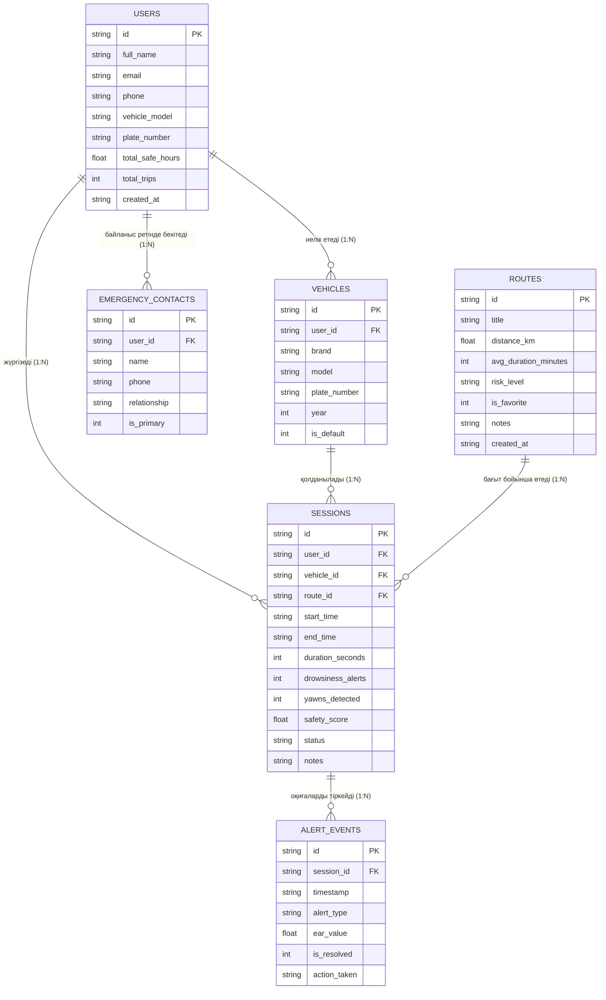

# ПРАКТИКАЛЫҚ ЖҰМЫС №4
## Тақырыбы: Локалды деректер базасы, CRUD операциялары, іздеу және сүзгілеу
### Жоба атауы: «AntiSleep AI» — Жүргізушінің ұйықтап кетуінің алдын алатын AI қауіпсіздік жүйесі

---

## 1. ҚОСЫМШАДА САҚТАЛАТЫН НЕГІЗГІ АҚПАРАТ ТҮРЛЕРІ

«AntiSleep AI» қосымшасы автокөлік жүргізушілерінің шаршауы мен көз жұмылуын (микроұйқы) алдын алатын мобильді кешен болғандықтан, 100% интернетсіз (оффлайн) режимде келесі негізгі ақпарат түрлерін сенімді жергілікті сақтауды қажет етеді:

1. **Жүргізуші профилі (Driver Profile):** Жүргізушінің аты-жөні, электрондық поштасы, байланыс телефоны, жинақталған қауіпсіз жүргізу сағаттары және жалпы орындалған сапарлар саны.
2. **Көлік құралы туралы мәліметтер (Vehicle Data):** Автокөліктің маркасы, моделі, мемлекеттік тіркеу нөмірі (GRNZ), шыққан жылы және негізгі таңдалған күйі.
3. **Жол қауіпсіздігі бағыттары мен трассалар (Routes):** Бағыт атауы, ұзындығы (км), орташа жүру уақыты, қауіптілік деңгейі (монотондылық, түнгі учаскелер, көлік тығыздығы), жүргізуші белгілеген «Таңдаулы» (Favorites) мәртебесі және арнайы ескертпелер.
4. **Мониторинг және сапар телеметриясы (Trip Sessions):** Белсенді көру камерасы арқылы тіркелген сапардың басталу/аяқталу уақыты, жалпы ұзақтығы, қауіпті ұйқы дабылдарының саны, есінеулер саны, қауіпсіздік индексі (0–100%) және нәтижелі статусы («Қауіпсіз», «Орташа», «Қатерлі»).
5. **Төтенше оқиғалар журналдары (Alert Events):** Сапар кезіндегі нақты уақыттағы микроұйқылар, есінеулер және алаңдаушылық сәттері, EAR (Eye Aspect Ratio) көз жұмылу коэффициенті және қабылданған әрекеттер (сирена ойнатылуы, жүргізушінің жауап беруі).
6. **Шұғыл байланыс контактілері (Emergency SOS Contacts):** Төтенше жағдайда жүргізуші дабылға жауап бермесе, автоматты хабарлама жіберілетін жақын адамдарының аты, телефоны және туыстық қатынасы.

---

## 2. ӨЗАРА БАЙЛАНЫСТЫ 6 ENTITY/MODEL ҚҰРЫЛЫМЫ

Пәндік салаға сәйкес Clean Architecture қағидатымен `lib/models/` бумасында 6 дербес және өзара логикалық байланысқан мәліметтер моделі жасалды:

1. **`UserModel` (`lib/models/user_model.dart`):** Жүйені пайдаланушы жүргізушінің аккаунтын сипаттайды.
2. **`VehicleModel` (`lib/models/vehicle_model.dart`):** Жүргізушінің автопаркіндегі тіркелген автокөліктерді сипаттайды.
3. **`RouteModel` (`lib/models/route_model.dart`):** Қауіпсіз бағыттар мен қалааралық тасжолдарды сипаттайды.
4. **`SessionModel` (`lib/models/session_model.dart`):** Компьютерлік көру арқылы бақыланған әрбір жеке сапар сессиясын сипаттайды.
5. **`AlertEventModel` (`lib/models/alert_event_model.dart`):** Сапар ішіндегі нақты ұйқы оқиғаларын сипаттайды.
6. **`EmergencyContactModel` (`lib/models/emergency_contact_model.dart`):** Төтенше SOS байланыс тұлғаларын сипаттайды.

Әр модельде деректерді көшіруге арналған `copyWith()`, SQLite жадына сақтауға арналған `toMap()` және базадан оқып алуға арналған `fromMap()` фабрикалық конструкторлары қарастырылған.

---

## 3. МОДЕЛЬ ӨРІСТЕРІ, ДЕРЕКТЕР ТИПТЕРІ ЖӘНЕ ИДЕНТИФИКАТОРЛАР КЕСТЕСІ

| Модель | Өріс атауы | Dart типі | SQLite типі | Кілт / Шектеу | Сипаттамасы |
| :--- | :--- | :--- | :--- | :--- | :--- |
| **UserModel** | `id` | `String` | `TEXT` | `PRIMARY KEY` | Пайдаланушының бірегей ID кілті |
| | `fullName` | `String` | `TEXT` | `NOT NULL` | Жүргізушінің толық аты-жөні |
| | `email` | `String` | `TEXT` | `NOT NULL` | Электрондық поштасы |
| | `phone` | `String` | `TEXT` | — | Байланыс телефоны |
| | `vehicleModel` | `String` | `TEXT` | `NOT NULL` | Ағымдағы көлік атауы |
| | `plateNumber` | `String` | `TEXT` | `NOT NULL` | Мемлекеттік тіркеу нөмірі |
| | `totalSafeHours`| `double` | `REAL` | `NOT NULL` | Апатсыз/қауіпсіз сағаттар қоры |
| | `totalTrips` | `int` | `INTEGER` | `NOT NULL` | Орындалған барлық сапарлар саны |
| | `createdAt` | `DateTime` | `TEXT` | `NOT NULL` | Тіркелген күні (ISO8601) |
| **VehicleModel**| `id` | `String` | `TEXT` | `PRIMARY KEY` | Көліктің бірегей ID кілті |
| | `userId` | `String` | `TEXT` | `FOREIGN KEY` | `users(id)` кестесіне сілтеме |
| | `brand` | `String` | `TEXT` | `NOT NULL` | Маркасы (Toyota, Scania, т.б.) |
| | `model` | `String` | `TEXT` | `NOT NULL` | Моделі (Camry 70, R500, т.б.) |
| | `plateNumber` | `String` | `TEXT` | `NOT NULL` | Мемлекеттік нөмірі |
| | `year` | `int` | `INTEGER` | `NOT NULL` | Шығарылған жылы |
| | `isDefault` | `bool` | `INTEGER` | `DEFAULT 1` | Негізгі көлік белгісі (1/0) |
| **RouteModel** | `id` | `String` | `TEXT` | `PRIMARY KEY` | Бағыттың бірегей ID кілті |
| | `title` | `String` | `TEXT` | `NOT NULL` | Бағыт атауы (Алматы — Қонаев) |
| | `distanceKm` | `double` | `REAL` | `NOT NULL` | Қашықтығы (км) |
| | `avgDurationMinutes`| `int` | `INTEGER` | `NOT NULL` | Орташа уақыты (минут) |
| | `riskLevel` | `String` | `TEXT` | `NOT NULL` | Қауіптілік деңгейі |
| | `isFavorite` | `bool` | `INTEGER` | `DEFAULT 0` | Таңдаулы бағыт жалаушасы (1/0) |
| | `notes` | `String` | `TEXT` | — | Жол туралы ескертпелер |
| | `createdAt` | `DateTime` | `TEXT` | `NOT NULL` | Қосылған уақыты |
| **SessionModel**| `id` | `String` | `TEXT` | `PRIMARY KEY` | Сапар сессиясының ID кілті |
| | `userId` | `String` | `TEXT` | `FOREIGN KEY` | `users(id)` сілтемесі |
| | `vehicleId` | `String` | `TEXT` | `FOREIGN KEY` | `vehicles(id)` сілтемесі |
| | `routeId` | `String?` | `TEXT` | `FOREIGN KEY` | `routes(id)` сілтемесі (NULL бола алады) |
| | `startTime` | `DateTime` | `TEXT` | `NOT NULL` | Сапардың басталған уақыты |
| | `endTime` | `DateTime` | `TEXT` | `NOT NULL` | Сапардың аяқталған уақыты |
| | `duration` | `Duration` | `INTEGER` | `NOT NULL` | Секундтарда сақталатын ұзақтық |
| | `drowsinessAlerts`| `int` | `INTEGER` | `NOT NULL` | Тіркелген ұйқы дабылдары |
| | `yawnsDetected`| `int` | `INTEGER` | `NOT NULL` | Есінеулер саны |
| | `safetyScore` | `double` | `REAL` | `NOT NULL` | Қауіпсіздік балы (0.0 – 100.0%) |
| | `status` | `String` | `TEXT` | `NOT NULL` | Сапар қорытынды мәртебесі |
| | `notes` | `String` | `TEXT` | — | Сапар жазбалары |
| **AlertEventModel**| `id` | `String` | `TEXT` | `PRIMARY KEY` | Оқиғаның бірегей ID кілті |
| | `sessionId` | `String` | `TEXT` | `FOREIGN KEY` | `sessions(id)` сілтемесі |
| | `timestamp` | `DateTime` | `TEXT` | `NOT NULL` | Оқиға тіркелген уақыт |
| | `alertType` | `String` | `TEXT` | `NOT NULL` | microsleep / yawn / distraction |
| | `earValue` | `double` | `REAL` | `NOT NULL` | Көз жұмылу коэффициенті (EAR) |
| | `isResolved` | `bool` | `INTEGER` | `DEFAULT 1` | Дабыл тоқтатылды ма (1/0) |
| | `actionTaken` | `String` | `TEXT` | — | Атқарылған әрекет (Сирена, діріл) |
| **EmergencyContactModel**| `id` | `String` | `TEXT` | `PRIMARY KEY` | Байланыс ID кілті |
| | `userId` | `String` | `TEXT` | `FOREIGN KEY` | `users(id)` сілтемесі |
| | `name` | `String` | `TEXT` | `NOT NULL` | Байланысатын тұлға аты |
| | `phone` | `String` | `TEXT` | `NOT NULL` | Телефон нөмірі |
| | `relationship`| `String` | `TEXT` | `NOT NULL` | Туыстық қатынасы (Жұбайы, досы) |
| | `isPrimary` | `bool` | `INTEGER` | `DEFAULT 1` | Негізгі контакт белгісі (1/0) |

---

## 4. МОДЕЛЬДЕР АРАСЫНДАҒЫ ЛОГИКАЛЫҚ БАЙЛАНЫС (ER DIAGRAM)

Деректердің тұтастығы мен нормализациялануын қамтамасыз ету мақсатында төмендегі реляциялық ER-диаграммасы (Entity-Relationship) іске асырылды:



* **Foreign Key шектеуі:** `PRAGMA foreign_keys = ON;` операторымен қосылған.
* **Каскадты өшіру:** Пайдаланушы өшкен жағдайда оның көліктері мен шұғыл контактілері (`ON DELETE CASCADE`), сапар өшкен жағдайда оның дабыл журналдары бірге тазартылады.
* **Қауіпсіз байланыс:** Бағыт өшірілген жағдайда бұрынғы сапарлардағы бағыт сілтемесі сақталып, бос мәнге (`ON DELETE SET NULL`) ауыстырылады.

---

## 5. ЛОКАЛДЫ ДЕРЕКТЕР ҚОРЫ: SQLITE ТАҢДАУ ЖӘНЕ ОНЫҢ НЕГІЗДЕМЕСІ

Жобада локалды деректер қоры ретінде **SQLite** (`sqflite` + `sqflite_common_ffi`) таңдалды:

### SQLite таңдалу себептері:
1. **Көпкестелік реляциялық құрылым:** AntiSleep AI жүйесі жүргізушілерді, олардың көліктерін, сапар сессияларын және қауіп оқиғаларын өзара Foreign Key кілттерімен байланыстырады. SQLite мұндай қатынастарды табиғи түрде басқарады.
2. **Күрделі SQL іздеу және сүзгілеу мүмкіндігі:** Бағыттар мен сапарларды қашықтығы, қауіптілік дәрежесі, уақыты бойынша сүзуде (`WHERE title LIKE ? AND is_favorite = 1 ORDER BY distance_km ASC`) стандартты SQL операторлары Hive-ке қарағанда әлдеқайда қуатты әрі икемді.
3. **ACID қасиеттері мен сенімділік:** Автокөлік қауіпсіздік жүйелерінде күтпеген жерден құрылғы сөніп қалса да, транзакциялардың толықтығы (Atomicity, Consistency, Isolation, Durability) деректердің бүлінуіне жол бермейді.
4. **Кросс-платформалық FFI интеграциясы:** `sqflite_common_ffi` кітапханасы арқылы Android пен iOS қана емес, сонымен бірге Windows және автоматты Unit-тесттер ортасында да бірыңғай база жұмыс істейді.

---

## 6. ПАКЕТТЕРДІ FLUTTER ЖОБАСЫНА ОРНАТУ ЖӘНЕ БАПТАУ

`pubspec.yaml` файлына келесі қажетті кітапханалар қосылып, сәтті синхронизацияланды (`flutter pub get`):

```yaml
dependencies:
  flutter:
    sdk: flutter
  cupertino_icons: ^1.0.6
  google_fonts: ^6.1.0
  camera: ^0.10.5+9
  audioplayers: ^5.2.1
  intl: ^0.19.0
  sqflite: ^2.3.0
  sqflite_common_ffi: ^2.3.0
  path: ^1.9.0
```

Windows жұмыс үстелі мен Unit-тест ортасында SQLite-ті қолдау үшін `lib/services/database_service.dart` файлында автоматты FFI анықтау блогы енгізілді:

```dart
static void setupFfiIfNeeded() {
  if (!kIsWeb && (Platform.isWindows || Platform.isLinux || Platform.isMacOS)) {
    sqfliteFfiInit();
    databaseFactory = databaseFactoryFfi;
  }
}
```

---

## 7. ДЕРЕКТЕР ҚОРЫН ИНИЦИАЛИЗАЦИЯЛАУ (`DatabaseService`)

`lib/services/database_service.dart` файлында Singleton паттернімен деректер қорын басқару қызметі құрылды:

```dart
class DatabaseService {
  static final DatabaseService instance = DatabaseService._init();
  static Database? _database;

  DatabaseService._init();

  Future<Database> get database async {
    if (_database != null) return _database!;
    _database = await _initDB('antisleep_ai.db');
    return _database!;
  }
...
```

* База файлы: `antisleep_ai.db`
* Кестелер автоматты түрде қосымша алғаш ашылғанда `_createDB` функциясында жасалады.
* Бастапқы күйде жүйені бос қалдырмай, бірден толыққанды сынау үшін `_seedInitialData` арқылы негізгі жүргізуші (`Арман Жұмабаев`), көлік (`Toyota Camry 70`), SOS байланыс (`Айгүл Жұмабаева`), 5 негізгі трасса және сапарлар мен дабыл тарихы енгізіледі.

---

## 8. CRUD ОПЕРАЦИЯЛАРЫ: CREATE (ЖАҢА ЖАЗБА ҚОСУ)

### 8.1. Бағдарламалық код (`DatabaseService`):
```dart
Future<int> insertRoute(RouteModel route) async {
  final db = await database;
  return await db.insert(
    'routes',
    route.toMap(),
    conflictAlgorithm: ConflictAlgorithm.replace,
  );
}
```

### 8.2. Экранда іске асуы (`search_screen.dart`):
* Пайдаланушы AppBar-дағы **«+» (Бағыт қосу)** белгішесін басады.
* Төменнен жартылай модальді терезе (`showModalBottomSheet`) ашылады.
* Мәліметтерді тексеру (Form Validation): Бағыт атауы, қашықтығы (оң сан), орташа жүру уақыты (минут), қауіп деңгейі чиптері және ескертпелер.
* «Бағытты сақтау» басылғанда деректер қорына жаңа ID-мен (`route-${timestamp}`) жазылып, сәтті қосылғаны туралы жасыл SnackBar хабарламасы көрсетіледі және экран жаңарады.

---

## 9. CRUD ОПЕРАЦИЯЛАРЫ: READ (ДЕРЕКТЕРДІ ОҚУ ЖӘНЕ КӨРСЕТУ)

### 9.1. Бағдарламалық код (`DatabaseService`):
```dart
Future<List<RouteModel>> getRoutes({
  String query = '',
  bool onlyFavorites = false,
  String? riskFilter,
  String sortBy = 'created_at',
  bool ascending = false,
}) async {
  final db = await database;
  // Сүзгілер мен сұрыптауды біріктіріп оқу
  final List<Map<String, dynamic>> maps = await db.query(
    'routes',
    where: whereString,
    whereArgs: whereArgs.isNotEmpty ? whereArgs : null,
    orderBy: '$sortBy ${ascending ? "ASC" : "DESC"}',
  );
  return maps.map((map) => RouteModel.fromMap(map)).toList();
}
```

### 9.2. Экранда іске асуы:
* `search_screen.dart` және `trip_list_screen.dart` экрандары ашылған сәтте `initState()` ішінде деректер қорынан мәліметтерді оқып, `ListView.builder` арқылы динамикалық карточкалар түрінде рендерлейді.
* Сапар ұзақтығы (`formattedDuration`), қашықтығы (`formattedDistance`) және қауіпсіздік деңгейі сәйкес түстік индикаторлармен безендіріледі.

---

## 10. CRUD ОПЕРАЦИЯЛАРЫ: UPDATE (БАР ЖАЗБАНЫ ӨЗГЕРТУ)

### 10.1. Бағдарламалық код:
```dart
Future<int> updateRoute(RouteModel route) async {
  final db = await database;
  return await db.update(
    'routes',
    route.toMap(),
    where: 'id = ?',
    whereArgs: [route.id],
  );
}
```

### 10.2. Экранда іске асуы:
* Карточкадағы үш нүкте менюінен **«Өңдеу» (Edit)** түймесін басқанда, ағымдағы мәндері толтырылған модальді өңдеу терезесі ашылады.
* Өзгерістер енгізіліп «Өзгерістерді сақтау» басылғанда деректер қорындағы тиісті жазба жаңартылып, «Бағыт өзгерістері сақталды! ✅» хабарламасы беріледі.
* Сонымен қатар `edit_vehicle_screen.dart` экранында көлік маркасы, мемлекеттік нөмірі, жылы және SOS контактісі өзгертіліп, SQLite-ке тұрақты сақталады.

---

## 11. CRUD ОПЕРАЦИЯЛАРЫ: DELETE (ЖАЗБАНЫ ӨШІРУ)

### 11.1. Бағдарламалық код:
```dart
Future<int> deleteRoute(String id) async {
  final db = await database;
  return await db.delete(
    'routes',
    where: 'id = ?',
    whereArgs: [id],
  );
}
```

### 11.2. Экранда іске асуы:
* Кездейсоқ өшірудің алдын алу үшін **Растау диалогы (AlertDialog)** қосылды.
* Пайдаланушыға: «Бағытты деректер қорынан өшіруді растайсыз ба?» деген сұрақ қойылады.
* Пайдаланушы «Өшіру» түймесін басқанда жазба SQLite базасынан толық жойылып, тізім автоматты жаңарады.
* `trip_list_screen.dart` экранында сапарларды солға сырғыту (`Dismissible`) арқылы өшіру мүмкіндігі де қолдау тапты.

---

## 12. ДЕРЕКТЕР ҚОРЫМЕН ЖҰМЫС ІСТЕЙТІН REPOSITORY ҚАБАТЫ

Жобада интерфейсті (UI) төменгі деңгейдегі SQL операторларынан ажыратып, таза архитектураны (**Repository Pattern**) құру үшін `lib/services/route_repository.dart` қабаты жасалды:

```dart
abstract class IRouteRepository {
  Future<List<RouteModel>> getAllRoutes({
    String query = '',
    bool onlyFavorites = false,
    String? riskFilter,
    String sortBy = 'created_at',
    bool ascending = false,
  });
  Future<RouteModel?> getRouteById(String id);
  Future<void> addRoute(RouteModel route);
  Future<void> updateRoute(RouteModel route);
  Future<bool> toggleFavorite(String id);
  Future<void> deleteRoute(String id);
}

class RouteRepository implements IRouteRepository {
  final DatabaseService _dbService;
  RouteRepository({DatabaseService? dbService})
      : _dbService = dbService ?? DatabaseService.instance;
  ...
}
```

Бұл тәсіл экран виджеттерін тікелей SQL синтаксисіне тәуелділіктен босатып, кодты оңай тестілеуге (Mocking) мүмкіндік береді.

---

## 13. ДЕРЕКТЕРДІ ІЗДЕУ (SEARCH) ФУНКЦИЯСЫ

* **Нақты уақыттағы іздеу:** `TextField`-ке мәтін енгізілген сайын `_searchController.addListener` оқиғасы шақырылып, базадан сүзгіленген мәліметтер сұралады.
* **SQL сұранысы:**
  ```sql
  WHERE (title LIKE '%query%' OR risk_level LIKE '%query%' OR notes LIKE '%query%')
  ```
* Іздеу өрісінде бір батырмамен тазартатын `clear` иконкасы және деректер табылмағанда бір басумен іздеуді тоқтататын батырма бар.

---

## 14. ДЕРЕКТЕРДІ СҮЗГІЛЕУ (FILTERING) КРИТЕРИЙЛЕРІ

Қосымшада деректерді терең талдау үшін бірнеше критерий бойынша сүзгілеу жүзеге асырылды:

1. **Қауіп деңгейі бойынша (Risk Level Filter Chips):**
   * «Барлығы» — барлық жолдар;
   * «Төмен» — жарықтандырылған қауіпсіз трассалар;
   * «Орташа» — түнгі немесе қарбалас учаскелер;
   * «Қатерлі» — ұзақ монотонды, жүргізушіні тез ұйықтататын қауіпті жолдар.
2. **Санаттық қойындылар (Tab Filtering):**
   * «Барлық бағыттар» қойындысы;
   * «Таңдаулылар (Favorites)» қойындысы.
3. **Сапарлар бойынша (`trip_list_screen.dart`):**
   * «Барлық сапарлар», «Қауіпсіз (100%)», «Қауіп дабылдары бар».

---

## 15. ДЕРЕКТЕРДІ КЕМІНДЕ ЕКІ ПАРАМЕТР БОЙЫНША СҰРЫПТАУ (SORTING)

Пайдаланушы жоғарғы панельдегі Сұрыптау батырмасын (`Icons.sort_rounded`) басып, келесі параметрлер бойынша бағыттар мен сапарларды сұрыптай алады:

1. **Қосылған уақыты бойынша (`created_at`):**
   * Жаңалары алдында (DESC);
   * Ескілері алдында (ASC).
2. **Қашықтығы бойынша (`distance_km`):**
   * Қысқадан ұзынға (ASC);
   * Ұзыннан қысқаға (DESC).
3. **Орташа жүру уақыты бойынша (`avg_duration_minutes`):**
   * Жылдам бағыттардан ұзақ бағыттарға қарай.
4. **Сапарлар тарихында:**
   * Уақыты бойынша немесе Қауіпсіздік индексі (`safety_score`) бойынша.

Интерфейсте таңдалған бағыттың бағыты (жоғары/төмен бағыттауыш стрелкалары) айқын көрініс табады.

---

## 16. ТАҢДАУЛЫЛАР (FAVORITES) ФУНКЦИЯСЫ

1. Әр бағыт карточкасында алтын түсті жұлдызша (`Icons.star_rounded` / `Icons.star_outline_rounded`) бар.
2. Жұлдызшаны басқанда SQLite-тегі `is_favorite` өрісі 1 немесе 0 мәніне инверсияланады (`toggleFavoriteRoute`).
3. Экранның төменгі бөлігінде ««Астана — Бурабай» таңдаулыларға қосылды ⭐» деген жедел хабарлама пайда болады.
4. Жоғарғы қойындыдағы «Таңдаулылар» тақтасына өткенде тек жүргізуші сақтаған сүйікті трассалары сүзіліп көрсетіледі.

---

## 17. ДЕРЕКТЕР БОЛМАҒАНДАҒЫ EMPTY STATE ХАБАРЛАМАСЫ

Іздеу сұранысы бойынша ешқандай бағыт сәйкес келмесе немесе деректер қоры бос болса, пайдаланушыға сапалы графикалық **Empty State** компоненті көрсетіледі:

* Көрнекілік: Үлкен сұр белгіше (`Icons.search_off_rounded` немесе `Icons.history_toggle_off_rounded`).
* Тақырып: «Бағыттар табылмады» немесе «Бұл санатта әзірге сапарлар жоқ».
* Түсіндірме мәтін: ««Қостанай» бойынша сәйкес бағыт табылмады» немесе «Сізде әлі таңдаулыға сақталған бағыттар жоқ».
* Әрекет түймесі: Іздеу кезінде «Іздеуді тазарту», ал база бос кезде «Жаңа бағыт қосу» шақыру батырмасы.

---

## 18. ҚАТЕЛЕРДІ ӨҢДЕУ ЖӘНЕ UI КЕРІ БАЙЛАНЫСЫ (ERROR HANDLING)

Барлық мәліметтер қорымен жұмыс жасайтын операциялар `try-catch` блоктарымен сенімді қорғалған:
* Базаға қосылуда немесе дұрыс емес өріс енгізілгенде қосымша апатты тоқтамайды (crash-safe).
* Қате туындағанда қызыл түсті ескерту `SnackBar` терезесі шақырылып, қазақ тілінде: «Сақтау кезінде қате орын алды: ...» хабарламасы шығады.
* Енгізу өрістерінде `validator` арқылы теріс сан, бос жол немесе жарамсыз жыл енгізуге шектеу қойылған.

---

## 19. ИНТЕРНЕТСІЗ (OFFLINE) ЛОКАЛДЫ ЖҰМЫС ІСТЕУІН ТЕКСЕРУ

«AntiSleep AI» архитектурасы 100% жергілікті ресурстарға негізделген:
* Барлық кестелер жергілікті смартфон немесе компьютер файлында (`antisleep_ai.db`) сақталады.
* Камера телеметриясы мен бетті тану процесі сияқты деректер қорына сақтау да құрылғыдан тыс серверге ешқандай желілік сұраныс жібермейді.
* Интернет байланысы толық өшірілген (Airplane Mode) жағдайында барлық Create, Read, Update, Delete, Search, Filter, Sort операциялары толыққанды, кідіріссіз орындалады.

---

## 20. ҚАЙТА ІСКЕ ҚОСҚАННАН КЕЙІНГІ ТҰРАҚТЫЛЫҚТЫ (PERSISTENCE) ТЕКСЕРУ

Деректердің қолданба жабылғаннан кейін де сақталып қалуы екі деңгейде тексерілді:

### 20.1. Автоматтандырылған тесттер нәтижесі:
`test/database_service_test.dart` тесттік модулі арқылы келесі 10 сценарийдің барлығы сәтті өтті:
1. Деректер базасының инициализациясы және бастапқы seed деректердің құрылуы.
2. Жаңа бағытты қосу (Create).
3. Барлық бағыттарды және жеке жазбаны ID арқылы оқу (Read).
4. Бағыт мәліметтерін өзгерту (Update).
5. Таңдаулы жалаушасын ауыстыру (Favorites toggle).
6. Бағытты деректер қорынан біржола өшіру (Delete).
7. Сөздік кілттер бойынша іздеу (Search).
8. Қауіптілік дәрежесі бойынша сүзу (Filter).
9. Қашықтық өсуі мен кемуі бойынша сұрыптау (Sorting).
10. Реляциялық байланыстар мен сапар/дабыл оқиғаларының жазылуы (Foreign Key Integrity).

### 20.2. Flutter Analyze нәтижесі:
```
Analyzing ПО проект 2 авто...
No issues found! (ran in 3.5s)
```
Код сапасы 100% таза, ешқандай ескерту немесе қате жоқ.

---

## 21. ҚОРЫТЫНДЫ

№4 Практикалық жұмыс барысында «AntiSleep AI» қосымшасына сенімді жергілікті деректер қоры (SQLite) толықтай енгізілді. 6 негізгі модель жасалып, олардың арасындағы реляциялық Foreign Key байланыстары бекітілді. Пайдаланушы интерфейсінде деректерді қосу, нақты уақытта іздеу, қауіптілік деңгейіне қарай сүзгілеу, параметрлер бойынша сұрыптау, таңдаулыларға қосу, өңдеу және растаумен өшіру мүмкіндіктері толыққанды, интернетсіз оффлайн режимде жұмыс істейтін дәрежеге жеткізілді.

